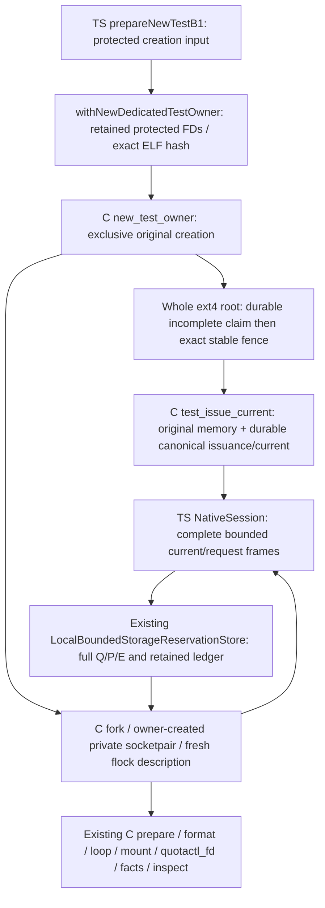

# NEW TEST native B1 owner source handoff

This preserves the original r1 producer handoff and records the corrective
`sr-storage-e2e-native-newtest-owner-20261010-r2` source work below. Physical qualification is
**UNRUN**. The next gate is a separate 6.1 xhigh independent source review before
any TEST host execution. Full A/B/C, P1, CI, rollout, B2 growth/drain and C2 remain
incomplete. No production grant, managed-launch policy, installation, credential,
registry, recovery database, real project or agent effect is part of this change.

The supplied main identity `c50c948535e4840ae876022430a1dfc381054b7b` is an input
assertion. Linked Git metadata is not visible here; there is no independently
verified remote head, commit, staged patch or integration receipt. The r1 producer reported
matching the three edited source hashes to its independent input report and
reading that report fully. That is historical producer evidence. Neither the
r1 scratch nor `.tmp-native-contract-input-r1/report.md` was materialized into
this r2 workspace. R2 read the supplied full contract and F1–F3 findings as data,
AGENTS/architecture and the actual native/adapter/runner/domain/store/tests. It
does not claim access to the independent reviewer's workspace or re-verification
of the original report or remote identity.

## Original ownership and code graph

`prepareNewTestB1` is an actual TypeScript operator composition function consumed
by the explicitly selected native suite. It reads a bounded protected 0400
creation input, opens retained creation-parent/policy/helper descriptors, and
calls adapter-only `withNewDedicatedTestOwner`. Neither function accepts an
existing filesystem, chosen generation/current binding or production receipt.
The entry is not exported through worker-core or the package public API.



Native bodies are in `storage-native.c` and its adapter-private included
`storage-new-test-owner.c` / `storage-new-test-owner-private.h`. Compile the
existing `storage-native.c` translation unit once; do not link a second copy of
the included file. Original creation and inner B1 preparation share actual
`format`, `loop_open`, `loop_check`, native quota/readback, image and mount identity
functions. This is not an alternative quota backend.

`new_test_owner` validates initial user namespace, real root UID/GID, protected
helper/tool/policy bytes, empty 0700 retained parents, different backing/control
hosting devices, finite budgets and available modules/syscalls. It creates its
own private mount namespace, makes propagation private in that namespace, creates
new origin directories exclusively, durably records incomplete intent, fully
allocates a new outer image, attaches its exact loop, formats that image, fully
allocates/readbacks again, and mounts its complete new ext4 root privately. It
checks raw UUID, root inode 2, statx mount ID, mountinfo root `/`, ext4 device,
private propagation, loop/backing identity and measured internal geometry. It
never remounts a shared scratch filesystem, loads a module, adopts an old image,
relocates root control or modifies shared quotas.

The fixed root claim `.bounded-storage-new-test-owner-v1` is exclusively created
as one root-owned 0600 single-link file on that verified whole filesystem root.
The incomplete claim and root directory are fsynced before creating the usable
control fence. The fence and control directory are fsynced before completing and
fsyncing the claim. The owner retains claim, namespace, backing, loop, whole-root,
control, policy, helper/tool and current-record descriptors. Subsequent commands
verify the retained and visible claim/current/fence identities and actual
machine/boot/filesystem/namespace/code/policy observations.

Ordinary `--registered-fd-session-v1` now proves a whole root and refuses the
TEST claim before opening or creating a fence. A subtree cannot hide the marker;
a whole-root alias encounters the same marker. Owner-coupled TEST holders cannot
substitute control roots or foreign namespace/mount/root identities. Incomplete
claims, missing current/ledger, unresolved publication intent or lost channels
are refusals. There is no reset, adoption, expiry takeover, remount, release,
cleanup-credit or failover path. Unrelated hostile privileged root remains outside
the original protected-custody operational scope.

## Private native ABI and bounded protocol

The sole TEST executable mode is `--new-test-owner-fd-session-v1`; TS selects it
through the closed `NativeStorageMode` enum and closes purpose to
`NewDedicatedTestPurpose.B1`.

| Boundary | Descriptor/protocol |
| --- | --- |
| Native owner startup | FD3 empty backing parent, FD4 empty control parent, FD5 actual 0400 TEST policy, FD6 exact protected ELF; FD7–10 inherited duplex invocation ingress |
| Owner retention | Duplicated parents/policy, exact tool/helper, outer backing/loop/root/control, namespace and claim/current FDs |
| Holder membership | Owner creates an anonymous `SOCK_SEQPACKET` socketpair and forks; only that child inherits its private endpoint. Original owner verifies live channel and actual claim. Private I/S exchanges durably acknowledge one-time ledger initialization and consult original owner memory; deleting both ledger and marker never allows reinitialization. Serialized PID/JSON/receipt/hash does not grant membership. |
| Holder locking | Fresh open description of the existing fence; `START1 pid`, then `WAIT1 pid dev ino` immediately before kernel `flock`, then `HELD1 dev ino` after acquisition. Claim validation precedes that lock. |
| Native issuance | `ADMIT` under that same stable fence, with no active holders. Native owns job/generation/project/operation identities, history uniqueness and monotonically durable revision. `CURRENT1 length` returns canonical request bytes plus newline. |
| Capability | `CAPABILITY length digest` plus complete canonical request; native compares original memory, retained current FD, visible record, historical issuance and claim. |
| Pending publication | Existing `PUBLISH oldLength newLength` and exact CAS bytes; native parses every complete canonical row, preserves all prior requests/E, requires an authorized current row for a new Pending and fsyncs ledger/directory before acknowledgement. |
| Physical prepare | `PREPARE_TEST length digest` plus the complete request. Native rechecks claim/current/receipt and exact Pending row, consumes this holder's post-ack permission once, then calls existing B1 prepare. Raw legacy PREPARE is unavailable in TEST mode. |
| Inspection | `INSPECT_TEST length digest` validates the actual historical issuance and exact ledger row, then native physical state/namespace/identities; it cannot arm preparation or make historical issuance current. |
| Holder completion | `END`, followed by parent-generated `EXIT1 status` after verified `waitpid`; ingress reuse starts a distinct fork. Native refusal closes commands in the TS holder and preserves terminal output for reaping. |
| Cancellation | `KILL pid` acts only on a tracked actual fork child; an already reaped owned PID returns DONE1 without killing any replacement process. Owner death triggers child PDEATHSIG. |
| Owner completion | `CLOSE` ends only owned children. No physical/control object is disposed. |

Private native structures on this GCC/x86_64 build: claim v1 **464 bytes**, native
issuance **2376 bytes**, TEST image state v2 **352 bytes**. Ordinary registered
image state v1 preserves its prior **272-byte** encoding. These binary records are
local evidence, not portable serialized grants. The canonical issuance text is
persisted separately; its SHA-256 is the returned receipt correlation. Native
history records must equal the original owner's in-memory issuance, and current
records must equal its actual retained current. A byte hash alone is insufficient.
SHA-256 is local native computation; it does not access keys/providers or load
kernel crypto modules.

Limits: at most 16 generations, 4 concurrent holders, 256 total holder forks,
1 hour of monotonic owner lifetime, 300-second whole TS command watchdogs,
2-second private liveness replies, 2048-byte request frames, 511-byte policy,
4 MiB ledger and 16 KiB cumulative native stderr. Q is finite and closed by actual
policy: <=1 GiB, <=65536 inodes, with representable positive both limits. Outer
image <=64 GiB. Actual measured outer geometry must support the finite plan's
physical allocation plus every standing full E and the unchanged 5 GiB/50000
inode floor. Hosting backing retains the same floor; control publication retains
5 GiB plus 32 MiB and the inode floor. Pending/Unknown/Blocked/Prepared retain E.

## Future operator input and selection — not executed here

The former pre-existing registration manifest has been removed from the native
suite's positive path. The new creation input has exactly these keys:

```json
{
  "purpose": "NEW_TEST_storage_b1_dedicated_ext4_no_real_projects",
  "backingParent": "/srv/workers/test-storage-b1-<operator-uuid>/new-parent",
  "controlParent": "/var/lib/subscription-runtime-test/test-storage-b1-<operator-uuid>/new-parent",
  "policyPath": "<absolute protected 0400 actual TEST policy file>",
  "helperPath": "<absolute protected reviewed ELF>",
  "helperSha256": "<exact reviewed ELF SHA-256>"
}
```

This deliberately updates the old branded path contract to **empty creation
parents**. Native code generates its own child origin name and creates `outer`
beneath that origin; no caller selects the mounted FS or authoritative control
binding. Parent directories must be root-owned 0700 with protected canonical
ancestry and different hosting devices. Control stays on its distinct filesystem;
the runner neither mounts nor relocates it. The operator supplies these initial
protected empty parents and actual bounded TEST policy after independent review.

For this suite, actual policy bytes are canonical JSON with exactly the following
order and **no trailing newline**; this is data shape, not a generated grant:

```json
{"purpose":"NEW_TEST_storage_b1_dedicated_ext4_no_real_projects","maxGenerations":8,"qBytes":"67108864","qInodes":"1024","outerBytes":"17179869184"}
```

Only the operator may run the explicit selected suite after review:

```text
BOUNDED_STORAGE_NEW_TEST_CREATION=<protected-main-creation-file> \
BOUNDED_STORAGE_NEW_TEST_OWNER_DEATH_PENDING_CREATION=<protected-fresh-pending-creation-file> \
BOUNDED_STORAGE_NEW_TEST_OWNER_DEATH_PREPARE_CREATION=<protected-fresh-prepare-creation-file> \
  node node_modules/vitest/vitest.mjs run \
  --config host-integration/bounded-storage/native.vitest.config.ts
```

No creation input is a **failure**, not a skip. Ordinary test discovery continues
to exclude this physical suite. Repeated invocation against nonempty creation
parents refuses; use a newly owned invocation rather than deleting/adopting old
objects. The two terminal owner-death tests run last on separate exclusively NEW
original-owner fixtures. The suite requires all three protected creation files
before any fixture setup. Each uses different empty creation parents; native
exclusive creation refuses reused/nonempty parents. Neither death fixture uses
the ledger-loss fixture, restores state or adopts a parent filesystem. There is no positive production
launch, unprivileged writer or project smoke runner in this composition.

## Historical r1 producer evidence

The following r1 paths and results were recorded by the original producer. Those
artifacts are not present in this r2 workspace; current evidence is listed below.

Visible machine ID measured before dependency/build work:
`d856d40da5ad4e23b4f67773e5942842`. Visible mountinfo/df identify ext4 hosting device
`/dev/nvme2n1p1`, major/minor `259:1`. Initial available bytes were
`287316373504`, above the unchanged `5368709120` floor. Scratch UUID
`d0f2cac1-2009-4e9d-a710-e156f417938f` was physically verified by the parent per
task input; it is **HIDDEN in this sandbox**, where block nodes and sysfs device
visibility are absent. It has not been re-measured here. CapEff/CapPrm/CapBnd are
zero. No root effects or escalations were attempted.

All downloads, npm cache, TMPDIR, exact builds, original source snapshots and
logs are in ignored workspace `.tmp-native-newtest-owner-r1/` (dependencies in
ignored workspace `node_modules/`). Installation used `npm ci --ignore-scripts`
with the pinned project lock, no global installation. Tooling: Node 24.21.0,
TypeScript 6.0.3, Vitest 4.1.8, GCC 13.3.0. The project lock SHA-256 is
`4de8cd9332eb1c95421482d66d3f6d076ef86aeb4b780558642bf071a6ad80f5`.

| Executed source check | Actual result / retained log |
| --- | --- |
| Exact native artifact build: `gcc -std=c11 -O2 -Wall -Wextra -Werror -D_FILE_OFFSET_BITS=64 host-integration/bounded-storage/native/storage-native.c -o .tmp-native-newtest-owner-r1/storage-native` | PASS / `gcc.log` |
| Pinned `node node_modules/typescript/bin/tsc --noEmit -p scripts/e2e-storage/tsconfig.json` | PASS; config explicitly includes actual adapter, operator, native suite, relevant domain/store and uses strict inherited flags plus `skipLibCheck:false` / `typecheck.log` |
| Dedicated `tsc --noEmit --skipLibCheck false -p host-integration/bounded-storage/tsconfig.json` | PASS / `host-typecheck.log` |
| Targeted safe policy/wire tests through scratch Vitest config | PASS, 2 files / 17 tests, including actual owned-child pipe backpressure/death / `boundary-tests.log` |
| Actual Node extra stdio duplex descriptor read/write with a real bounded child | PASS / `duplex-boundary.log`; transport only, no native setup/current or physical effect |
| Actual native SHA-256 function, standard empty/abc/multiblock/million-a vectors, via scratch C harness | PASS / `hash-boundary.log`; harness does not call native entry/setup/claim/prepare or any privileged effect |

Root-project typecheck/build, full boundaries/CI and physical suite were not run;
no claim that root config covers excluded host-integration sources is made.
Exact final source/artifact/log/patch hashes are in scratch `exact-hashes.json` /
`SHA256SUMS`; `source.patch` includes exactly the eight owned deliverables. The
handoff manifest records check exit codes and evidence paths. Original snapshots
are retained for the three existing edited sources.

## Physical matrix and remaining gates

Every physical scenario below is **UNRUN**. Source tests are reviewable obligations,
not evidence of kernel behavior, and no skip is counted as qualification.

| Physical scenario | Source preparation / qualification status |
| --- | --- |
| New fully allocated outer ext4, real identity/claim/current, genuine B1 allocation/geometry/project limits/inheritance | Actual native owner + shared B1 functions; positive native suite rewritten to consume issued current/generation. UNRUN. |
| Stable fence with two distinct holders | Retain the first holder until `/proc/locks` independently proves the exact second owned PID waiting on the same dev major/minor/inode and first PID lock; then release and verify order/inode. Whole-owner physical scenario UNRUN. Isolated real-kernel acquisition proof and two red mutations executed in r2. |
| Different control roots before initial ledger and later; subtree; ordinary legacy bypass | Original first holder plus ROOT2/SUBFS/LEGAC actual native boundary probes, asserting no competing fence/debit. UNRUN. |
| Actual revision advance and complete current substitutions | Raw native frames for stale revision and wrong machine/boot/dev/UUID/job/generation/project/policy/receipt/revision/operation/Q/P/E, correct digest of changed bytes; actual native refusal before effects. UNRUN. |
| Arbitrary new Pending / digest coincidence for a different request | Raw native PUBLISH without capability and authorized capability followed by changed complete row; exact ledger/intent assertions. UNRUN. |
| Pending fsync acknowledgement then genuine holder death | Positive generation/current issued by original owner; throws only after actual Pending ack, owner survives; reopen/reconcile retains same E, Absent becomes Blocked, no replay. UNRUN. |
| Missing ledger plus initialization marker | Both objects renamed to retained evidence names; actual native reinitialization must refuse against original owner memory. No deletion/restore/reset. UNRUN. |
| Original owner death | Two exclusively NEW protected fixtures with intact native current/ledger and retained ingress: authorized new Pending; separately actual Pending ACK before authorized PREPARE. Kill exact owner outside callback, raw retained channel writes bypass TS guards, verify remote EOF/no ACK/exact holder termination and retained ledger/state evidence. UNRUN. |
| Byte and inode EDQUOT, synthetic descendant/alias/write-surface confinement | Separate bounded real-kernel qualification remains required; quota readback/geometry tests do not substitute. UNRUN, no qualification harness added here. |
| Whole-root bind aliases/foreign namespace, code/claim/fence replacement, inode/symlink/hardlink/propagation substitutions | Native custody/whole-root/current refusal bodies are implemented; broader privileged matrix remains UNRUN. |
| Partial/lost Prepared ack and all fsync/rename crash points; outer/control reserve/overflow/unsupported/FD exhaustion | Durable native state/intents retained, no reset/adoption body; exhaustive crash/budget injection remains UNRUN. |
| A lifetime/source FD transfer/current barrier, B2 grow/drain/seal, C2/project integration, P1/CI/rollout | Outside this TEST B1 composition and incomplete. |

No known source seam is left as a declaration or permanent refusal stub:
`new_test_owner`, `test_holder`, `test_issue_current`,
`require_test_owner_current`, `test_publication`, `test_prepare_current`,
`test_request_command`, `withNewDedicatedTestOwner`, `admitPreparation` and the
operator composition have concrete bodies. Their privileged behavior remains
unverified and must withstand the independent source review before execution.
No physical test pass or production authority is claimed.

## R2 corrective source and retained evidence

The rejected materialization provenance supplied by the controller is snapshot
`d12338b1459f9e33a23fd4d9c5aa8dde9e97707305102659b59b479d894bcfa5`, id
`d55e32c646387e2351f79e9ad0846bf6351181a359c508fc624df3693e013670`.
These are input assertions, not locally verified registry identities. Exact
materialized eight-path baseline hashes and original bytes are retained in
`.tmp-native-newtest-owner-r2/baseline-hashes.json` and `original/`.

F1 changes the physical suite's synchronization: WAIT1 only identifies the
attempt. `observeOwnedFenceWait` reads bounded real `/proc/locks`, checks both
processes' exact live parent/PID/start ticks, same observable PID namespace and
Linux dev major/minor/inode, and requires the first held row and the second
waiting row under the same kernel lock id. Hidden/ancestor-mounted procfs,
unsupported identities and observation expiry are failures. Polling delays are
never evidence. Startup refusal and proof failures also release the first holder
and await both callbacks. Original WAIT placement and lock semantics remain.
The only C change extracts those existing acquisition statements into
`test_acquire_fence`, called by the original native `test_holder`.

F2 adds adapter-private terminal probes which write complete real PUBLISH or
PREPARE_TEST frames directly to the already retained native ingress, bypassing
command/stopped guards. The suite independently retains protected control,
current and claim read descriptors. It checks actual CAPABLE1 on each fresh
fixture, and actual durable Pending publication/readback before the PREPARE
probe. The owner PID, holder PID/start ticks and ingress slot are bound before
killing the exact original owner. Native EOF, no acknowledgement, terminated
owned processes, unchanged canonical ledger and absent intent/native state are
required. TS post-stop refusals remain extra checks only. `terminate` waits for
the exact owner's process exit with a 5-second bound, not stdio close, so a
holder's inherited stderr cannot deadlock the kill/callback barrier.

F3 accepts the existing native `Uncertain` refusal for the actual lost+found
SUBFS probe, whose fixed whole-root claim read returns ENOENT. Competing-control,
legacy-session and no competing fence/debit checks are preserved.

Correction graph: physical suite → actual TypeScript runner kernel observations;
operator runner → original retained owner → original native private holder →
`test_acquire_fence` → original claim/current/publication/physical B1 bodies.
Terminal suite → same leased NativeSession/TestHolderWire ingress → actual
socket write/EOF plus exact kernel process observations. No worker-core contract,
production admission, quota implementation, claim/issuance encoding, registry or
cleanup/adoption body was replaced. Native local record sizes remain claim 464,
issuance 2376, TEST image 352, registered image 272 bytes.

R2 verified before package data: machine
`d856d40da5ad4e23b4f67773e5942842`, ext4 `/dev/nvme2n1p1` (`259:1`), available
`252268437504` bytes above the unchanged `5368709120` floor, and available RAM
`47881830400` bytes. Scratch UUID remains HIDDEN here and parent-asserted as
`d0f2cac1-2009-4e9d-a710-e156f417938f`. Capability masks were zero. Linked Git
metadata is hidden; no Git mutation, commit or push was attempted.

All R2 dependencies, pinned-lock installation, npm tool/cache, TMPDIR, builds,
source copies and logs are within ignored `.tmp-native-newtest-owner-r2/`.
No root node_modules link or global install was created. Npm 11.6.2 was downloaded
there with verified registry SHA-512 because npm was absent; `npm ci
--ignore-scripts` used the unchanged project lock. Actual tools: Node 24.21.0,
GCC 13.3.0, TypeScript 6.0.3, Vitest 4.1.8. Strict scratch TypeScript configs
extend the owned pinned `scripts/e2e-storage/tsconfig.json`; only module/type
resolution points at scratch dependencies. They include the actual runner,
adapter, native suite and safe helper harness and keep `strict` and
`skipLibCheck:false`. Effective configuration is retained.

| R2 executed source check | Actual exit / evidence under scratch |
| --- | --- |
| Full native translation unit GCC13 `-std=c11 -O2 -Wall -Wextra -Werror -D_FILE_OFFSET_BITS=64` | 0; `storage-native`, `logs/gcc.log` |
| Strict TS6 no-emit actual runner/adapter/suite and safe kernel harness | 0; `logs/typecheck.log`, `kernel-tsconfig.json`, `effective-tsconfig.json` |
| Existing policy/wire/native mountinfo parser tests | 0; 3 files / **24 meaningful tests**, no skips; `logs/safe-tests.log` |
| Safe kernel harness calling exact native `test_acquire_fence`, retaining first holder until actual kernel wait | 0; `logs/kernel-positive.log`, `kernel-positive-proof.json`; no native entry/setup/mount/quota called |
| Same regression, full-TU negative control removing actual flock | **1, expected red**: exact wait unobserved; `logs/kernel-removed-flock.log` |
| Same regression, full-TU negative control reusing inherited shared OFD | **1, expected red**: exact wait unobserved; `logs/kernel-shared-ofd.log` |
| Local binary record sizes, safe sizeof-only harness | 0; `logs/abi.log`; no native entry called |

The raw owner-death regressions and all other whole-owner/physical matrix entries
remain **UNRUN**. The safe kernel lock proof is limited to the exact acquisition
function and observer; it is not whole-owner, current/claim, quota or native death
qualification. Full A/B/C, P1, CI, rollout, B2 and C2 remain incomplete. Separate
independent 6.1 xhigh corrective SOURCE review is retained in scratch
`independent-source-review.md` before any future operator TEST execution; source
review does not authorize or establish live qualification.

The corrective diff changes only the owned native owner C, adapter, native suite,
TypeScript operator/helper and this existing handoff. The other three original
owned paths remain byte-identical. `source.patch`, `exact-hashes.json`,
`SHA256SUMS`, `checks.json` and `report.md` retain exact source/artifact/log hashes,
commands and actual exit codes. No physical resource cleanup or recovery action
was run or added.
